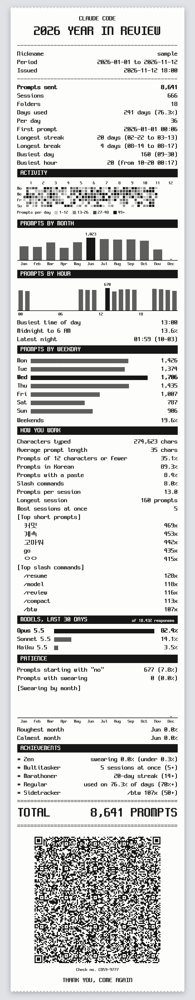

# vibe-check

코딩 에이전트와 보낸 1년을 영수증 한 장으로 뽑아 드립니다. 지금은 Claude Code만 됩니다.

**https://luftaquila.github.io/vibe-check/** · [English](README.md)



## 쓰는 법

1. 페이지의 프롬프트를 복사해 Claude Code에 붙여 넣습니다.
2. 닉네임과 연도를 알려 주면 Claude가 내 컴퓨터에서 기록을 세어 숫자만 페이지로 보냅니다.
3. 페이지가 영수증을 그립니다. 영수증의 QR을 찍으면 같은 영수증이 다시 열립니다.

페이지와 영수증은 영문이 기본이고, 위쪽 스위치로 둘 다 한글로 바꿀 수 있습니다.

## 구조

- `prompt.md`: 프롬프트. 세는 규칙과 JSON 형식이 들어 있고, 도구(python, node, jq 등)는 에이전트가 고릅니다. 규칙은 영문 한 벌이고, 한글 페이지에서는 머리말과 영수증 언어 값만 바뀝니다.
- 전달: 에이전트가 `#j=<base64url JSON>`을 엽니다. 페이지가 값을 검증하고 발행 시각을 찍은 뒤 주소를 정식 형태로 바꿉니다.
- 정식 주소: `#<버전>.<검증 번호>.<데이터>`. 데이터는 JSON을 raw deflate로 압축해 base64url로 바꾼 것이고, 검증 번호는 그 JSON 바이트의 SHA-256 앞 8자리입니다. `#` 뒤는 서버로 가지 않습니다.
- 검증 번호로 주소 속 내용을 고쳤는지 알 수 있습니다. 계산법이 공개돼 있어서 작정하고 고친 것까지는 못 막습니다.
- `core.js`는 값 검증, 주소 인코딩, 다른 값에서 나오는 값(사용한 날, 연속 기록, 비중, 모델 이름) 계산을 맡습니다. `receipt.js`는 캔버스에 영수증을 그리고, `app.js`는 페이지를 움직입니다.

## 개인정보

- 기록은 내 컴퓨터에서만 세고, 영수증에는 자주 쓴 짧은 프롬프트 5개 말고는 내가 쓴 문장이 들어가지 않습니다.
- 주소나 QR을 받은 사람은 영수증 내용을 볼 수 있습니다.

## 개발

```
node --test                      # core.js 테스트
python3 -m http.server 8765      # http://127.0.0.1:8765/ 열기
```

`og.png`는 링크 미리보기 이미지이고, 원본은 `tools/og.html`입니다.

## 언어

욕설 목록은 고정돼 있지 않습니다. 프롬프트가 어떤 언어를 쓰는지 묻고, 에이전트가 그 언어의 욕설과 정정("아니") 정규식 패턴을 직접 만듭니다. 검사는 정규식 일치로만 합니다. 에이전트마다 목록이 달라서 이 두 수치는 사람마다 기준이 조금 다를 수 있습니다.

닉네임과 영수증에 찍히는 짧은 프롬프트는 한글과 영문만 됩니다. 영수증 글꼴이 그 글자만 지원하기 때문입니다.

## 라이선스

MIT. `LICENSE` 참고. 서드파티 파일은 각자의 라이선스를 따릅니다.

## 서드파티

- 글꼴 Neo둥근모 Code: SIL Open Font License 1.1 (`fonts/OFL.txt`)
- qrcode-generator: MIT (`vendor/qrcode-LICENSE.txt`)
