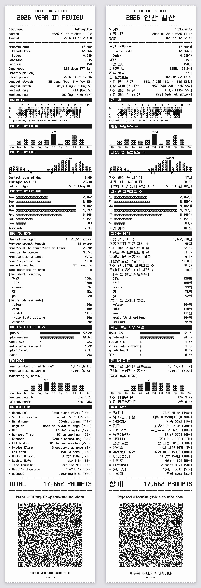

# vibe-check

A receipt for your year with a coding agent. Works with Claude Code and Codex.

**https://luftaquila.github.io/vibe-check/**



## How to use

1. Copy the prompt from the page and paste it into Claude Code or Codex.
2. Answer four questions: a nickname, the year, the languages you write in, and which tools to include.
3. The agent counts your history on your computer and opens the page, which draws the receipt.

The QR code on the receipt opens the same receipt again.

## Privacy

- Your history is counted only on your computer. What you typed stays off the receipt, apart from your five most used short prompts.
- The numbers travel in the part of the URL after `#`, which is never sent to a server.
- Anyone you give the URL or QR code to can read the receipt.

## Development

```
node --test                      # tests for js/core.js
python3 -m http.server 8765      # then open http://127.0.0.1:8765/
```
